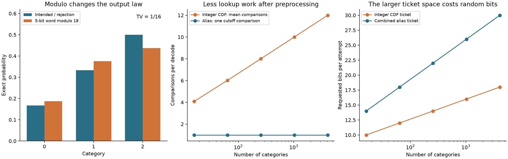

# Integer alias sampling

Weighted sampling can silently lose a tiny category when floating-point
cumulative sums stop changing. Mapping a random binary word with `% bound`
can introduce a different bias. This project implements **sampling with
replacement from nonnegative integer weights**, preserving the intended table
probabilities exactly and making the random-bit assumption explicit.

The core package uses only the Python standard library. It includes immutable
alias tables, exact output-mass verification, rejection-based bounded integers,
portable JSON, a CLI, independent integer-CDF references, and reproducible
finite-state experiments. The algorithm is the classical alias construction
expressed with integer masses; this is an original implementation, not a new
sampling method.

## Reproduce

Python 3.11 or newer. From the repository root:

```bash
python3 -m venv .venv
source .venv/bin/activate
python -m pip install -r requirements-repro.txt
python -m pip install --no-deps .
python -m pytest -q
python -m integer_alias.demo --output results
integer-alias audit results/table.json
integer-alias sample results/table.json --count 10000 --seed 731
```

The pinned file includes plotting and test dependencies; the package itself has
no runtime dependencies. Alternatively, `python -m pip install '.[test]'`
resolves compatible dependency ranges. CI runs the tests, complete demo, and CLI
on Python 3.11 and 3.13. No network is needed after installation.

## Exact table geometry

For weights `w[0], ..., w[n-1]`, remove their common divisor `g` and define
`v[i] = w[i]/g`, `W = sum(v)`. The table has `n` implicit columns, each containing
`W` integer cells. Column `j` assigns its first `cutoff[j]` cells to output `j`
and its remaining cells to `alias[j]`.

Construction starts with masses `n*v[i]`. A category with mass below `W` gets a
column, filled to height `W` by a category with excess mass. The donor's residual
mass returns to a worklist. Exact integer arithmetic avoids tolerances and
probability clipping. All remaining masses are exactly `W`.

An independent pass through the completed table verifies, for **every** output:

```text
M[i] = cutoff[i] + sum(W - cutoff[j] for j where alias[j] == i)
     = n * v[i].
```

The formula includes self-alias contributions. Given a uniform ticket
`T in {0, ..., n*W-1}`, the decoder computes

```text
column, row = divmod(T, W)
output = column if row < cutoff[column] else alias[column]
```

Consequently `P(output=i) = M[i]/(n*W) = w[i]/sum(w)`. This proof counts an
implicit lattice; it does not allocate or enumerate `n*W` cells. Positive
weights retain positive mass, zero weights cannot be selected, and scaling all
weights by a positive integer leaves the reduced table unchanged.

Verification also runs on direct construction and JSON loading. It verifies
consistency with the supplied weights, not authenticity of the file. A different
valid table for the same weights is accepted. The arrays are converted to tuples
and the table is frozen, so mutating input lists cannot invalidate it later.

## From bits to a uniform ticket

For bound `B=n*W > 1`, request `k=(B-1).bit_length()` bits. Accept the integer word
if it is below `B`; otherwise request a fresh word. Under independent uniform
`k`-bit words, every accepted ticket has the same probability. A power-of-two
bound accepts every word. Bound one needs no bits.

The acceptance probability is `B/2^k > 1/2`. With unbounded retries, expected
attempts are `2^k/B < 2`, and expected requested bits are `k*2^k/B`. The actual
implementation caps attempts at 1,024 by default and raises `SamplingError` on
exhaustion, with no fallback sample. Under the ideal bit model the failure
probability is `(1-B/2^k)^1024 < 2^-1024`; conditional on success, the ticket
remains uniform. These formulas describe the bit model, not a measured PRNG
quality guarantee.

The API accepts a `getrandbits(k)` callable. It checks the type and range of each
word, but cannot establish independence or uniformity. A source returning zero
forever passes range checks and produces biased output. Python's `random.Random`
is used only for reproducible smoke samples and CLI sampling; it is a finite
state pseudorandom generator and is **not cryptographic**. A valid table cannot
repair a biased or correlated bit source. Floating real-valued weights and
sampling without replacement are outside this package's scope.

## Results

All examples use explicit synthetic integer weights. No external, private, or
personal data are used. Distribution comparisons below are exact enumerations
or exact cell counts, not inferred from Monte Carlo frequencies.



**Modulo bias.** For weights `[1,2,3]`, the alias lattice has 18 cells. Enumerating
all 32 five-bit words gives:

| Category | Intended law | Word modulo 18 | Rejection, conditional on acceptance |
| --- | ---: | ---: | ---: |
| 0 | 1/6 | 3/16 | 1/6 |
| 1 | 1/3 | 3/8 | 1/3 |
| 2 | 1/2 | 7/16 | 1/2 |

The modulo law has total variation distance `1/16` from the intended law.
Rejection accepts `9/16` of words, with `16/9` expected attempts without a cap.
This is a counterexample to the modulo shortcut, not a claim that modulo is
always biased: when the bound divides the word-space size, modulo is uniform.

**Tiny positive categories.** For weights `[2^60,1,1]`, each rare category has
probability `1/(2^60+2)`. The integer table assigns each rare output exactly three
cells. The persisted table supplies valid tickets reaching both outputs.
A deliberately simple baseline converts weights to binary64 and cumulatively
adds them in the listed order. Its three cumulative values are all `2^60`;
both rare categories have zero increment width. This demonstrates one specific
floating-CDF failure, not a verdict on every floating-point sampler. The combined
rare probability is `1/576460752303423489`, so under iid draws the mean waiting
time for either rare output is 576,460,752,303,423,489 draws. An ordinary short
frequency test cannot meaningfully validate these probabilities. Table geometry
can validate the exact mass without observing a rare draw.

**Work and randomness tradeoff.** For 16 to 4,096 categories, weights follow
`1 + (37*j+11) % 97`. The demo measures integer-CDF comparisons on 1,024
deterministically spaced tickets, versus one alias cutoff comparison. It also
reports the different bit widths needed for each ticket space. These are
operation counts, **not wall-clock speed measurements**. CDF lookup uses a
precomputed cumulative array; its preprocessing is not included in the lookup
counts. Only lookup comparisons are counted; input range checks are excluded
for both decoders. Alias decoding also needs a big-integer division, a comparison, and
array accesses. The larger combined alias ticket uses about `log2(n)` extra bits
per attempt in these examples. Rejection costs and expected requested bits are
reported separately in `results/summary.json`.

Construction and verification take `O(n)` integer operations and `O(n)` stored
integers. A decode uses a fixed number of integer operations; this is not
constant bit complexity when weights grow. This implementation prioritizes
transparent arithmetic and validation, and makes no performance claim against
compiled samplers or optimized bit-recycling algorithms.

The seed-731, 10,000-draw sample in the summary is a reproducibility smoke check
only (category counts: 1,695, 3,285, 5,020). Exact enumeration is the primary
evidence for distribution correctness.

## Python API

```python
from fractions import Fraction
from random import Random
from integer_alias import build

table = build([0, 1, 2, 3])
assert table.probabilities() == (Fraction(0), Fraction(1, 6),
                                 Fraction(1, 3), Fraction(1, 2))
print(table.cell_counts())
print(table.draw(Random(731).getrandbits))
```

For repeated draws, create one RNG instance and keep using it; reinitializing it
on each draw repeats its initial state. `table.decode(ticket)` is useful for
independent enumeration and deterministic checks. `uniform_below(bound,
getrandbits, max_attempts=1024)` is separately available.

The core accepts Python `int` weights (not booleans, floats, NumPy integers, or
decimal strings), up to 100,000 categories and 4,096 bits per weight. At least
one weight must be positive. Those resource limits are implementation choices.
The integer GCD is removed internally; the original input weights remain in the
table for auditability. Changing weights requires rebuilding the table.

## CLI and table format

Input weights use **canonical decimal strings**, preserving large integers when
JSON passes through systems that store numbers as binary64:

```json
{"weights": ["1", "2", "3"]}
```

```bash
integer-alias build results/weights.json > /tmp/integer-alias-table.json
integer-alias audit /tmp/integer-alias-table.json
integer-alias sample /tmp/integer-alias-table.json --count 10000 --seed 731
```

The versioned `integer-alias-v1` table contains `weights`, `cutoffs`, and
`aliases`. Weights and cutoffs are decimal strings; bounded alias indices are
JSON integers. Unknown fields, duplicate fields, noncanonical decimals, invalid
indices, and incorrect mass allocations are rejected. Files are limited to
16 MiB, so some extreme valid in-memory tables exceed the CLI input limit.
All commands read their input without modifying it and write results to stdout.
Use a different output path when redirecting `build`; the shell can truncate an
input file before the program starts if the same path is used for redirection.

`sample` reports category counts, not a list of individual draws. Its draw-count
limit is one million. Exit status is 0 on success, 1 for invalid input, and 2 for
a sampling error (argparse also uses 2 for command-syntax errors). There is no
implicit table repair or silent truncation of weights.

## Validation

The validation suite has 72 passing tests, including every nonzero weight
vector of lengths one to four with entries in `{0,1,2,3}` (336 vectors). They
enumerate the entire alias lattice and compare its law with
an independent integer-CDF decoder, which uses a different ticket space. Other
tests cover exact large-integer mass counts, zero support, GCD scaling, cutoff
boundaries, rejected bit words, rejection-budget exhaustion, corrupt JSON,
table immutability, CLI reproducibility, and invalid inputs. No test relies on
a lucky Monte Carlo frequency threshold.

The synthetic chart and four JSON artifacts can be regenerated with the demo.
The tests validate implementation behavior under specified inputs; they do not
certify the quality or independence of a caller's random-bit source.

## References

- Vose (1991), [A Linear Algorithm for Generating Random Numbers with a Given
  Distribution](https://doi.org/10.1109/32.92917), describes linear-time alias
  initialization. This repository implements the construction with integer mass
  units and adds explicit table verification and bit-source diagnostics.
- The [Python random documentation](https://docs.python.org/3/library/random.html)
  documents `getrandbits`, the pseudorandom generator, and the use of floating
  arithmetic by `choices` versus integer arithmetic by `choice`. The floating
  baseline here is explicitly implemented as cumulative binary64 addition; it is
  not a replication of every detail of `random.choices`.

MIT licensed. The implementation, tests, diagnostics, and examples were written
for this repository.
